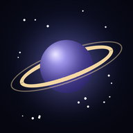

# Second Brain Atlas

A personal notes app that arranges connected ideas as a galaxy of planets. The web manifest and service worker support a standalone, offline-capable experience. The owner’s notes are encrypted, and the app opens at its unlock screen.



## Run locally

Serve the repository root with a static HTTP server. With Python 3 installed, run:

```sh
python -m http.server 8000 --bind 127.0.0.1
```

Open `http://127.0.0.1:8000/`. The owner’s code is required to open the encrypted collection.

## Implementation

HTML, CSS and browser JavaScript provide the interface. `manifest.webmanifest` contains app metadata and icons, and `sw.js` supports offline use.
